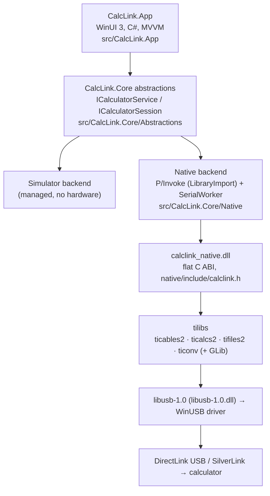

# CalcLink architecture

CalcLink is a thin, modern Windows shell around **tilibs**, the calculator-protocol libraries behind TiLP:
* libticables2 (cables)
* libticalcs2 (calculator protocols)
* libtifiles2 (TI file formats)
* libticonv (character sets)

tilibs is about 72k lines of mature C/C++. CalcLink doesn't fork or rewrite it; it replaces only what sits above it.

## 1. Layers

| Layer | Responsibility | Must not |
|---|---|---|
| **App** (`src/CalcLink.App`) | <ul><li>UI, view models, settings (`%LOCALAPPDATA%\CalcLink\settings.json`), file dialogs, drag and drop</li><li>Feature gating via `ICalculatorSession.Features`</li></ul> | Call native code, or know about tilibs types |
| **Core abstractions** (`Abstractions/*.cs`) | <ul><li>The contract: `ICalculatorService` (probe, connect, classify file) and `ICalculatorSession` (one link)</li><li>Value types such as `CalcInfo`, `CalcVariable`, `TransferProgress`, `ScreenImage`</li><li>Enums whose numbers mirror tilibs (`CalcModel`, `CableModel`, `CalcFeatures`)</li></ul> | Depend on WinUI |
| **Native backend** (`Native/`) | <ul><li>Implements the contract over `calclink_native.dll`</li><li>Marshals structs and UTF-8 strings</li><li>Owns one worker thread per session</li><li>Maps error codes to exceptions</li></ul> | Leak pointers into the App |
| **Simulator** | <ul><li>Implements the same contract with in-memory calculators</li><li>Used for UI work, tests, CI, and machines without a driver or hardware (ARM64 today)</li></ul> | — |
| **calclink_native.dll** (`native/`) | <ul><li>A small C++ shim that exposes a flat, versioned C ABI (`CL_ABI_VERSION`)</li><li>Hides GLib, tilibs handles and callbacks</li></ul> | Expose GLib types, or keep state that isn't per-session |
| **tilibs** | <ul><li>Cable I/O, calculator protocols, file formats, charset conversion</li><li>Built from source with CMake + vcpkg</li></ul> | — (upstream code; changes go upstream) |

### Backend selection

`CalculatorServiceFactory.Create(CalculatorBackend.Auto)` tries the native backend and falls back to the simulator:

* **When the native backend is used.** `IsNativeAvailable` is true only if `calclink_native.dll` loads and `cl_abi_version()` equals the ABI version the C# side was built for.
* **Choosing manually.** Users can also pick the backend in Settings.
* **Where `calclink_native.dll` is looked for.** `NativeRuntime.CandidatePaths` tries, in order:
  1. `CALCLINK_NATIVE_PATH` (environment override, for development);
  2. `<appdir>\calclink_native.dll`;
  3. `<appdir>\native\<rid>\calclink_native.dll`;
  4. `<appdir>\runtimes\<rid>\native\calclink_native.dll`.

  The DLL is loaded by absolute path with `LOAD_LIBRARY_SEARCH_DLL_LOAD_DIR`, so its dependencies (GLib, iconv, libusb-1.0) resolve from the same folder.
* **Packaged layout.** Packages use `native\<rid>\` (see `installer/Build-Portable.ps1`) to keep the third-party DLLs (GLib, iconv, libusb) out of the app root. The native library is deliberately named `calclink_native.dll`. A plain `calclink.dll` would clash with the app's managed `CalcLink.dll`, because Windows file names are case-insensitive.

## 2. Threading model

* **One worker thread per session.**
  * Each native `ICalculatorSession` owns a `SerialWorker`: a dedicated background thread that runs queued work items one at a time, in order.
  * tilibs handles aren't thread-safe, and the C ABI says so: "a `cl_session` is NOT thread-safe".
  * So every `cl_*` call for a session runs on that session's thread. Sessions for different calculators get different threads. In principle they can run in parallel, but tilibs keeps some process-wide state (library init, and the default libusb-1.0 context used for probing). Probing while another session is transferring has not been verified.
* **Async surface.**
  * Every session method returns a `Task` and is safe to call from the UI thread.
  * A call queues a work item, and its continuation runs asynchronously, never inline on the worker.
* **Progress.**
  * tilibs reports progress through the shim's `cl_progress_fn`. The callback runs on the worker thread, in the middle of the native call.
  * The backend forwards it to the caller's `IProgress<TransferProgress>`. `Progress<T>` created on the UI thread marshals to the UI by itself.
  * Callbacks must be quick and must never call back into the same session.
* **Cancellation.** It works in two stages:
  * **Still queued.** The task is cancelled immediately and the work never runs.
  * **Running.** The `CancellationToken` registration calls **`cl_cancel(session)`**, the one function that may be called from any thread. The shim sets tilibs' `CalcUpdate.cancel` flag. tilibs checks that flag between packets and aborts with `ERROR_ABORT`, which the shim maps to `CL_E_CANCELLED` (−5).

  After a cancelled transfer, the calculator may need a moment, or a reconnect, before the link is usable again.
* **Disconnects.** `ICalculatorSession.Disconnected` is raised on the worker thread when the link is lost. UI handlers must dispatch to the UI thread themselves (`DispatcherQueueExtensions` in the App).
* **Shutdown.** `DisposeAsync` stops accepting work, lets queued items finish, calls `cl_close`, and joins the thread.

## 3. Error model

| Source | Value | Surfaces in C# as |
|---|---|---|
| Success | `CL_OK` = 0 | — |
| tilibs (cables, calcs, files, conv) | > 0, for example `ERROR_ABORT` 256 (mapped to −5), timeouts, "not ready" | `CalcLinkException(code, message)` |
| Shim | < 0: `CL_E_INVALID_ARG` −1, `CL_E_NO_MEMORY` −2, `CL_E_NOT_SUPPORTED` −3, `CL_E_NOT_OPEN` −4, `CL_E_CANCELLED` −5, `CL_E_BAD_FILE` −6, `CL_E_INTERNAL` −7 | `CalcLinkException`. Codes −3 and −5 have special forms (see below). |

* **Messages.** The text comes from `cl_error_message(code)`, which wraps the tilibs `*_error_get` functions and returns UTF-8 (freed with `cl_free`).
* **Unsupported operations.** Before calling native code, Core checks the model's `CalcFeatures` (`OPS_*`/`FTS_*` bits from `cl_features`). An operation the model doesn't support throws `FeatureNotSupportedException` (code −3) and never reaches the calculator. The App uses the same bits to hide or disable commands.
* **Cancellation** shows up in one of two ways:
  * an `OperationCanceledException`, if the work was cancelled while still queued;
  * a `CalcLinkException` with `IsCancellation == true` (code −5), once the work was running.

  The UI treats both as "cancelled by user", not as an error.
* **Logging.** Library log output goes through GLib's log handler, which the shim can redirect. Wiring it to a log viewer is on the roadmap.

## 4. Why a C shim instead of P/Invoking tilibs directly

tilibs' public API was designed for C callers in the same process (TiLP/GTK). Binding it directly from C# would be fragile:

* **GLib data structures.**
  * Directory listings come back as `GNode` trees of `VarEntry*`, with folders as inner nodes: `ticalcs_calc_get_dirlist(handle, GNode** vars, GNode** apps)`.
  * Walking them needs GLib's node layout and `ticalcs_dirlist_destroy`.
  * The shim flattens them into a `cl_var[]` array with UTF-8 strings and an opaque back-pointer for later calls (`cl_recv_var`, `cl_delete_var`...).
* **Callbacks without context.**
  * Progress and cancel go through `CalcUpdate` (`ticalcs.h`), a struct with a `cancel` flag, counters, and **`void (*)(void)` function pointers** (`start`, `stop`, `refresh`, `pbar`, `label`). These carry no user/context argument.
  * Reverse P/Invoke into that would need a static trampoline and global state.
  * The shim gives each session its own `CalcUpdate` and maps it to `cl_progress_fn(void* user, ...)`. That makes per-session progress and thread-safe `cl_cancel` straightforward.
* **Encodings.**
  * Variable names are stored in each calculator's own character set. They need `ticonv_varname_to_utf8` and friends, with model-specific rules.
  * File paths cross into GLib, which expects UTF-8 on Windows.
  * The shim's rule is simple: **every string across the ABI is UTF-8**, including detokenized display names, and C# uses `StringMarshalling.Utf8`.
* **Struct and enum stability.**
  * `CalcInfos`, `VarEntry`, `CableHandle` and `CalcHandle` are large and contain GLib types. Their layout has changed between tilibs versions.
  * The shim exposes small fixed-layout structs (`cl_device`, `cl_calc_info`, `cl_var`, `cl_clock`) with explicit `int32_t`/`uint*` fields and reserved bytes. It versions them with `CL_ABI_VERSION`, which Core checks at load.
  * Core's tests check the managed struct layouts.
* **Ownership and lifetime.**
  * One `cl_open` replaces the multi-step cable/calc handle dance: `ticables_handle_new` → `ticalcs_handle_new` → `ticalcs_cable_attach` → ..., plus the reverse on close.
  * All library memory is freed through `cl_free*`, so GLib's `g_free` and the CRT heap never mix across the boundary.
* **One dispatcher for files.** `cl_send_file` classifies the file and picks the right tilibs call: send var, group, app, OS, backup, TIGroup or certificate. The C# side therefore needs no per-format logic.

The cost is one more small DLL and a C ABI to maintain. The ABI is deliberately coarse: one call per user-visible operation.

## 5. Build and packaging (summary)

See [BUILDING.md](BUILDING.md) for commands.

* **Native.** `native/CMakePresets.json` uses Ninja + MSVC + vcpkg (manifest mode). The presets are `win-x64-release`, `win-x64-debug` and `win-arm64-release`. `cmake --install` produces `calclink_native.dll`, the tilibs/GLib/libusb runtime DLLs, and `clprobe.exe`.
* **.NET.** .NET 10, WinUI 3 with the Windows App SDK, **unpackaged and self-contained**. There is no MSIX, no framework package and no runtime prerequisite.
* **Packaging.**
  * `installer/Build-Portable.ps1` publishes per RID, adds `native\<rid>\`, and produces `CalcLink-<version>-<rid>-portable.zip`.
  * `installer/CalcLink.iss` (Inno Setup 6) builds a per-user installer per architecture. Specifically, it:
    * installs to `{autopf}\CalcLink`;
    * registers "Open with" file associations under HKCU;
    * has no shared DLLs and installs no drivers.
  * winget templates are in `installer/winget/`.
* **CI** (`.github/workflows/`):
  * `ci.yml` builds and tests on every push/PR. Both architectures are cross-compiled on x64 runners.
  * `release.yml` runs on `v*` tags. It optionally Authenticode-signs with Azure Trusted Signing, builds the installers, and publishes a GitHub release.

## 6. Licensing

* **CalcLink: GPL-2.0-or-later** (`LICENSE`). tilibs is licensed "GPL-2.0 or (at your option) any later version", and calclink_native.dll and the app link to it in the same process. That makes the combined work GPL. GPL-2.0-or-later keeps CalcLink compatible with tilibs and leaves room for GPL-3.0 combinations.
* **MIT dependencies.** .NET runtime and libraries, Windows App SDK / WinUI 3, CommunityToolkit.Mvvm and Microsoft.Extensions.* are MIT-licensed, which is GPL-compatible to ship with.
* **vcpkg-built dependencies.** Each ships under its own license; all of them are GPL-compatible:
  * GLib and gettext's libintl: LGPL-2.1+
  * libiconv: LGPL
  * zlib: Zlib
  * libarchive: BSD-2
  * libusb-1.0: LGPL-2.1+

  A `THIRD-PARTY-NOTICES` file listing them should ship in the packages (roadmap).
* **Source availability.** Every binary release is built from a public tag, so the corresponding source is the tag itself (including the tilibs revision it pins). Please attach the source archive to the release if a distribution channel requires it.
* **Trademarks.** "TI", "TI-84 Plus", "TI-Nspire" and other model names are trademarks of Texas Instruments. CalcLink is not affiliated with TI.

## 7. Roadmap

Derived from AUDIT.md §3 (calculator functionality) and §2.6 (USB). S/M/L are rough effort sizes.

### 7.1 USB modernisation: done in CalcLink, to be upstreamed

* **Done.** CalcLink builds tilibs on Windows with its **libusb-1.0** backend (`src/linux/link_usb1.cc`) instead of libusb-win32, through `native/patches/tilibs-0001-windows-libusb-1.0-backend.patch`. The patch adds a `TICABLES_WIN32_LIBUSB1` CMake option and makes `win32_check_libusb` check libusb-1.0 init. `vcpkg.json` uses `libusb` instead of `libusb-win32`. Result: **WinUSB** support (inbox driver signed by Microsoft) and, in principle, **ARM64 USB**.
* **Why it mattered.** On a SilverLink + TI-83 Plus, libusb-win32 1.4 sent commands but every reply came back empty, while WinUSB through libusb-1.0 worked immediately (see `docs/DRIVERS.md` §2).
* **Still to do.**
  * Offer the patch upstream to tilibs.
  * Test DirectLink models (TI-84 Plus family, TI-89 Titanium, Nspire) and an ARM64 PC.
* **Done: "Set up USB driver".** `native/tools/calclink-driver.c` is a small self-contained helper. `list` reports each connected TI device's driver without elevation. `install` (run elevated, only on the user's click) does libwdi's WinUSB steps for one TI hardware ID:
  * writes an INF that includes `winusb.inf`, and a catalog;
  * signs the catalog with a one-off self-signed certificate whose private key is deleted after signing;
  * trusts that certificate machine-wide;
  * forces the package onto the device.

  After every scan, the app (`DriverSetupService`, Devices page) checks whether any TI device has no usable driver, and offers the button if so. The check also runs when the scan listed the device: libusb enumerates a SilverLink on TI's driver but can't open it. See `docs/DRIVERS.md` §3.

### 7.2 Features

| # | Feature | Notes | Size |
|---|---|---|---|
| 1 | **Rename / move / archive / lock on the calculator** | Already in the ABI (`cl_rename_var`, `cl_set_attr`) and gated on `OPS_RENAME` / `OPS_CHATTR`. **On the TI-84 Plus CE family, tilibs has `OPS_IDLIST`, `OPS_RENAME` and `OPS_CHATTR` commented out** (`libticalcs/trunk/src/calc_84p.cc`). CE support needs upstream tilibs work and testing first. | S (UI) + M (tilibs) |
| 2 | **OS-upgrade safety checks** | Before sending an OS: check `battery_ok`, compare the OS/boot versions with the file's, and warn on downgrades (CE anti-downgrade). | M |
| 3 | **Remote keypad** | `cl_send_key` exists; the work is clickable per-model keypads from tilibs' key tables (`ticalcs_keys_*`), gated on `OPS_KEYS`. | M |
| 4 | **Live screen mirror** | Poll `cl_recv_screen` on the session worker at a user-chosen rate, with frame dropping. Also add copy to clipboard and scaling. | M |
| 5 | **"Send and run"** | `cl_execute` after sending, where the model supports it. | S–M |
| 6 | **Hotplug / auto-reconnect** | Register for Windows device-interface notifications (`CM_Register_Notification` / `WM_DEVICECHANGE`, filtered to VID `0451`). Re-probe on arrival and raise `Disconnected` on removal. tilibs has no hotplug API (AUDIT §3.4), so this lives in Core. | M–L |
| 7 | **CLI** (`calclink-cli`) | Probe, dirlist, send, receive, backup, screenshot, clock, ROM dump and OS version, built on Core, for classrooms and scripting. Each verb maps to one existing session method. | M |
| 8 | **Content preview** | Show pictures/images (`.8ci`, `.8ca`) as images, and TI-Basic listings. TI-Basic detokenisation isn't in tilibs and needs its own token tables. | L |
| 9 | **Multiple calculators at once** | The contract already allows several sessions, one worker each. The work is UI, plus probe results that distinguish identical devices. | L |
| 10 | **Protocol/event log viewer** | Hook `ticalcs_calc_set_event_hook` / `ticables_cable_set_event_hook` in the shim and stream the events to a log pane. Needs an ABI addition. | M |
| 11 | **TCP / emulator cables** | `CABLE_TCPC` / `CABLE_TCPS` for emulators. `CableModel` already has the values. | S |
| 12 | **Certificates** | Send/receive certificates (`FTS_CERT`). Send already goes through `cl_send_file`; receive needs an ABI call. | S |

### 7.3 Library-side gaps to raise upstream

* There are no distinct model IDs for CE-T, CE Python or Nspire CX vs CX II. Python support can only be detected at runtime (`python_on_board`).
* There's no bundle support (`.b84` / `.b83`) and no CX II OS formats (`.tco2` / `.tcc2` / `.tct2`).
* There's no hotplug API (see feature 6).

### 7.4 Packaging

* `THIRD-PARTY-NOTICES`.
* Signed uninstaller, using Inno `SignTool` wired to Trusted Signing.
* Automated winget submission once the package ID is final.
* MSIX, only if it ever becomes useful: now that drivers aren't part of the installer, it is technically possible.
